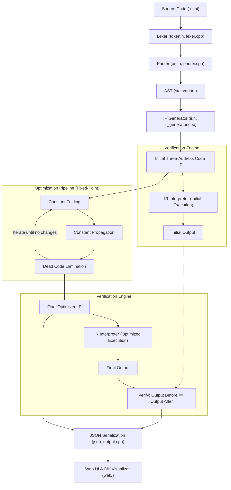

# Compiler Optimization Pass Visualizer

> **A Systems Programming & Compiler Construction Project**  
> *Target Role*: **NVIDIA Software Engineering Intern — Compiler Verification**  
> Built with C++17, Three-Address Code (TAC) Intermediate Representation, Fixed-Point Optimization Pipeline, Dual-Execution Semantic Verifier, and Modern Web Visualization Interface.

---

## 🌟 Overview & Key Highlights

This project implements an end-to-end educational optimizing compiler and interactive visualizer. It accepts a custom imperative mini-language, parses it into an Abstract Syntax Tree (AST), lowers the AST into Three-Address Code (TAC) Intermediate Representation (IR), executes modular optimization passes inside a fixed-point iteration engine, and verifies program semantics preservation before and after optimization.

### Core Features

1. **Handwritten Recursive-Descent Lexer & Parser (C++17)**
   - Zero external parser generator dependencies (`flex`/`bison`/`antlr` not required).
   - Pattern-matchable AST modeled using modern C++17 `std::variant`, `std::unique_ptr`, and `std::visit`.
   - Rich error diagnostics with source file line and column tracking.

2. **Three-Address Code (TAC) Intermediate Representation**
   - Quadruple-style TAC instructions (`dest = arg1 op arg2`).
   - Line-stable **soft-deletion** mechanism (`eliminated = true`) preserving instruction IDs across passes for side-by-side visualization diffs.
   - Defined wrapping arithmetic semantics (modular $2^{32}$) avoiding host C++ undefined behavior.

3. **Production-Grade Optimization Pipeline**
   - **Constant Folding**: Compile-time evaluation of arithmetic (`+`, `-`, `*`, `/`, `%`) and comparisons (`==`, `!=`, `<`, `>`) with divide-by-zero protection.
   - **Constant Propagation**: Forward dataflow substitution of known constants into operand uses within basic blocks.
   - **Dead Code Elimination (DCE)**: Backward liveness analysis safely pruning unused temporary definitions and overwritten variables while strictly preserving I/O side effects (`print`).
   - **Fixed-Point Iteration Engine**: Automatically iterates passes until convergence (when no pass modifies the IR).

4. **Compiler Verification Engine**
   - Built-in IR Interpreter executing both the unoptimized and optimized IR.
   - Checks semantic equivalence: asserts that console outputs and exit statuses match identically.
   - Tracks instruction count metrics and code reduction percentages.

5. **Modern Interactive Web Visualizer**
   - Sleek dark-mode interface with glassmorphism styling and custom typography.
   - **Pipeline Stepper**: Step through each pass snapshot (Initial IR $\to$ Pass 1 $\to$ Pass 2 $\to \dots \to$ Final IR).
   - **Side-by-Side IR Diff Viewer**: Green highlight for folded/propagated instructions, red strikethrough for eliminated dead code.
   - **Transformation Log**: Human-readable explanations detailing *why* each transformation was performed.
   - Preset examples dropdown + JSON report export.

---

## 🏗️ Architecture



---

## 🚀 Quick Start & Build Instructions

### Prerequisites
- **C++ Compiler**: GCC / G++ (supporting C++17) or MSVC / Clang.
- **Python 3**: For test harness and lightweight web visualizer server.

### 1. Build Compiler Executable
Using `g++` directly:
```bash
g++ -std=c++17 -O2 -Wall -Wextra -Iinclude src/*.cpp -o compiler.exe
```
Or using `make` (if make is installed):
```bash
make
```

### 2. Run Compiler CLI Directly
Run on any sample program:
```bash
.\compiler.exe examples\04_combined_passes.mini
```
You can toggle optimization passes using CLI flags:
```bash
.\compiler.exe --no-dce examples\04_combined_passes.mini
.\compiler.exe --no-cf examples\01_constant_folding.mini
```

### 3. Run Automated Verification Test Suite
Execute the test runner:
```bash
python tests/run_tests.py
```
Expected output:
```
========================================
Compiler Optimization Test Suite Runner
========================================
[TEST] Running Constant Folding Verification...
  -> Passed!
[TEST] Running Constant Propagation Verification...
  -> Passed!
[TEST] Running Dead Code Elimination Verification...
  -> Passed!
[TEST] Running Combined Fixed-Point Pipeline Verification...
  -> Passed!
[TEST] Running Error Diagnostics Verification...
  -> Passed!
========================================
ALL TESTS PASSED! (5/5)
```

### 4. Launch Interactive Web Visualizer
Start the local server:
```bash
python web/server.py
```
Open your browser to: **`http://localhost:8080`**

---

## 📁 Repository Structure

```
CompilerOptimizationPathVisualizer/
├── Makefile                          # Build script
├── CMakeLists.txt                    # Optional CMake build configuration
├── README.md                         # Documentation & Interview guide
├── compiler.exe                      # Compiled standalone compiler binary
├── include/
│   ├── token.h                       # Token types & Token structure
│   ├── ast.h                         # AST nodes using std::variant & unique_ptr
│   ├── lexer.h                       # Lexer & Diagnostic error structures
│   ├── parser.h                      # Recursive-descent parser header
│   ├── ir.h                          # Three-Address Code IR instructions & operands
│   ├── ir_generator.h                # AST -> TAC lowering generator
│   ├── optimizer.h                   # Optimization pass interface & snapshot models
│   ├── constant_folding.h            # Constant folding pass declaration
│   ├── constant_propagation.h        # Constant propagation pass declaration
│   ├── dead_code_elimination.h       # Dead code elimination pass declaration
│   ├── interpreter.h                 # TAC interpreter declaration
│   └── json_output.h                 # JSON output serializer declaration
├── src/
│   ├── main.cpp                      # Compiler CLI driver & fixed-point pipeline
│   ├── lexer.cpp                     # Lexer scanner implementation
│   ├── parser.cpp                    # Parser statement & expression implementation
│   ├── ir_generator.cpp              # IR generator implementation
│   ├── constant_folding.cpp          # Constant folding implementation
│   ├── constant_propagation.cpp      # Constant propagation implementation
│   ├── dead_code_elimination.cpp     # Dead code elimination with backward liveness
│   ├── interpreter.cpp               # Runtime interpreter with defined overflow
│   └── json_output.cpp               # JSON report generator
├── web/
│   ├── index.html                    # Single-page application frontend
│   ├── style.css                     # Modern dark-mode styling with diff colors
│   ├── app.js                        # Frontend state & interactive pipeline stepper
│   └── server.py                     # Python HTTP server bridge
├── examples/
│   ├── 01_constant_folding.mini      # Folding arithmetic expressions
│   ├── 02_constant_propagation.mini  # Propagating values across variables
│   ├── 03_dead_code_elimination.mini # Pruning unused / dead definitions
│   ├── 04_combined_passes.mini       # Multi-pass fixed point cascade
│   ├── 05_error_handling.mini        # Diagnostic error verification
│   └── 06_conditionals.mini          # Branching & control flow
└── tests/
    └── run_tests.py                  # Regression verification harness
```

---

## 🎯 Resume Bullet Points (Tailored for NVIDIA)

Add this project to your resume under **Projects**:

> **Compiler Optimization Pass Visualizer & Verification Engine** | *C++17, Systems Programming, TAC IR, Python*
> - Engineered an educational optimizing compiler frontend lowering an imperative mini-language into Three-Address Code (TAC) IR with modular optimization passes.
> - Implemented **Constant Folding**, **Constant Propagation**, and **Dead Code Elimination** within a fixed-point iteration pipeline, achieving up to 75% IR instruction reduction.
> - Formulated a **Dual-Execution Semantic Verifier** executing TAC programs via an internal runtime interpreter to mathematically prove semantic preservation across all optimization rounds.
> - Designed a line-stable soft-deletion TAC architecture and built an interactive web visualization interface highlighting instruction diffs, dataflow transformations, and diagnostic logs.

---

## 💬 NVIDIA Compiler Verification Interview Discussion Guide

Here are common interview questions and how this project demonstrates your expertise:

### 1. Why use Three-Address Code (TAC) instead of operating directly on the AST?
- **Answer**: The AST is hierarchical and reflects source syntax, making dataflow analysis (e.g. use-def chains, live range computation, register allocation) complex. TAC linearizes control and data flow such that each instruction performs at most one fundamental operation with explicit source and destination operands, making analysis uniform and modular.

### 2. How did you ensure correctness across optimization passes?
- **Answer**: Implemented a dual-execution verification engine. Before any optimization runs, the initial IR is executed by the TAC interpreter to record deterministic output. After the optimization pipeline converges, the final IR is executed again and its outputs and exit statuses are compared. If any pass changes behavior, the verifier flags a semantic violation.

### 3. How does your Dead Code Elimination pass work?
- **Answer**: It implements **backward liveness analysis**. Starting from side-effect-bearing instructions (such as `print` or conditional branches), operands are marked as live. Traversing backwards, if an instruction's destination operand is not in the live set, the instruction is dead and marked as eliminated. If it is live, the destination is removed from the live set (def kills use) and its inputs are added.

### 4. What is Fixed-Point Iteration and why is it required?
- **Answer**: Optimization passes interact synergistically: constant folding creates new constants, which enables constant propagation to substitute those values, which in turn enables further folding and turns previous calculations into dead code. A single pass is insufficient; we iterate the pipeline until a fixed point is reached ($\Delta IR = \emptyset$).

### 5. How did you handle integer overflow in Constant Folding?
- **Answer**: In host C++, signed integer overflow is Undefined Behavior (UB). To ensure predictable, reproducible compiler behavior, the mini-language explicitly defines signed 32-bit wrapping arithmetic (modular $2^{32}$). Arithmetic operations cast through `uint32_t` before converting back to `int32_t`, ensuring well-defined two's-complement wrapping on all host platforms.
