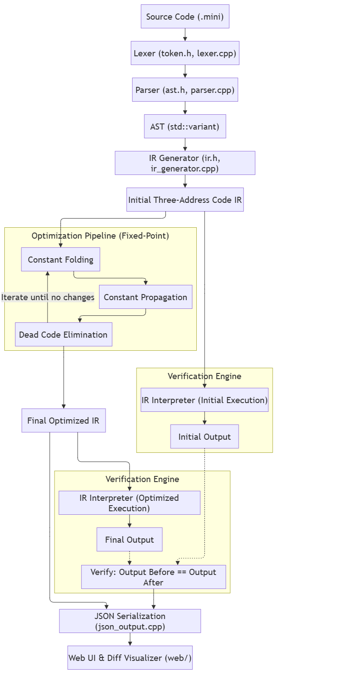

# Compiler Optimization Pass Visualizer

An experimental C++17 optimizing compiler with an interactive web visualizer. It parses a small imperative language, lowers it to Three-Address Code (TAC), applies optimization passes, and verifies that optimization preserves program behavior.

## Features

- Handwritten lexer and recursive-descent parser with source diagnostics.
- TAC IR with stable instruction IDs and defined 32-bit wrapping arithmetic.
- Constant folding, constant propagation, dead-code elimination, and fixed-point iteration.
- IR interpreter for comparing optimized and unoptimized output.
- Interactive visualizer with pipeline snapshots, side-by-side IR diffs, transformation logs, preset examples, and JSON export.

---

## Architecture



---

## Quick Start

### Prerequisites
- C++17 compiler (GCC, Clang, or MSVC)
- Python 3

### Build

```bash
g++ -std=c++17 -O2 -Wall -Wextra -Iinclude src/*.cpp -o compiler.exe
```

### Run the compiler

```bash
.\compiler.exe examples\04_combined_passes.mini
```

Disable passes when needed:

```bash
.\compiler.exe --no-dce examples\04_combined_passes.mini
.\compiler.exe --no-cf examples\01_constant_folding.mini
```

### Run tests

```bash
python tests/run_tests.py
```

### Launch the visualizer

```bash
python web/server.py
```

Open [http://localhost:8080](http://localhost:8080).
